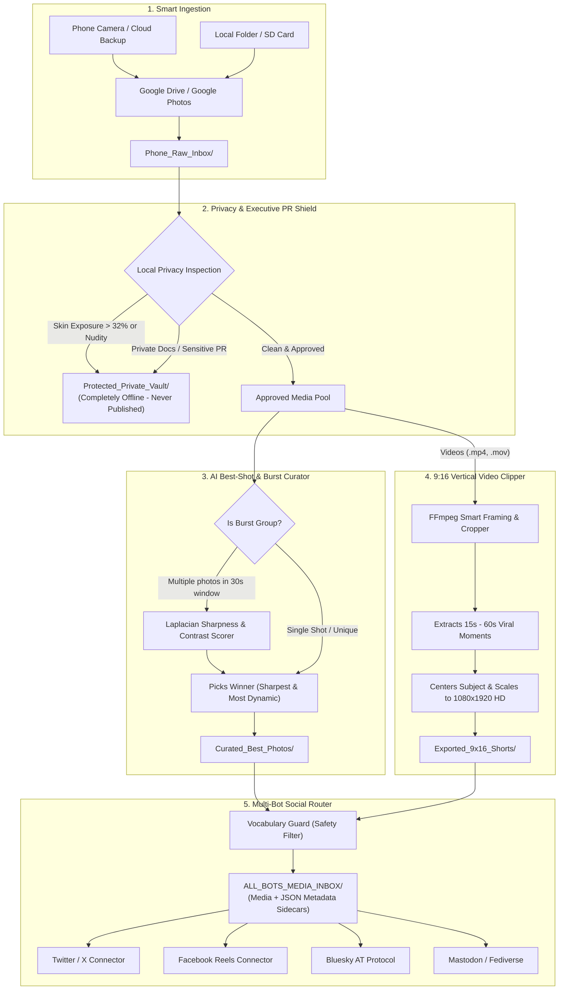

# AI Media Shorts & Auto-Clipper Studio

[](https://www.python.org/)
[](https://ffmpeg.org/)
[](https://ollama.ai/)
[](LICENSE)
[]()

> **A 100% Free, Local AI Studio for Auto-Generating 9:16 Social Shorts, Curating Best Shots, Enforcing Executive Privacy/PR Shields, and Publishing Across Multi-Platform Social Media Bots.**

---

## Overview

**AI Media Shorts** is an end-to-end autonomous media processing pipeline designed to eliminate tedious manual video editing, burst photo sorting, and social media scheduling. 

It functions as a completely free, local alternative to cloud subscriptions like CapCut Pro, OpusClip, and Hootsuite. Everything runs on your own hardware or workstation with zero watermarks, zero monthly fees, and strict privacy guarantees.



---

## Key Features

- **🎬 Smart 9:16 Vertical HD Video Engine:** Automatically re-frames horizontal footage into vertical 1080x1920 HD Shorts/Reels/TikToks using FFmpeg, chopping long videos into bite-sized clips with zero watermarks.
- **🛡️ 100% Local Privacy & PR Shield:** Uses local YCbCr skin tone thresholding and local Ollama vision models to detect intimate personal photos, nude shots, medical records, or sensitive private documents. Flagged files are quietly moved into a secure local vault—never uploaded or published anywhere.
- **📸 AI Best-Shot & Burst Curator:** Takes bursts of 10–20 photos captured on your phone, clusters them by timestamp, and computes Laplacian variance and contrast metrics to select only the single sharpest, most vibrant photo from each burst.
- **🚫 Universal Vocabulary Guard:** Built-in linguistic filter that automatically scrubs forbidden words and inappropriate terminology from post titles, descriptions, and hashtags before anything reaches social networks.
- **🤖 Multi-Platform Bot Adapters:** Included connectors for Twitter/X, Facebook Pages & Reels, Bluesky, and Mastodon with automatic JSON sidecar metadata handling, retry logic, and dispatch ledgers.
- **🖥️ Dark-Mode Desktop GUI:** A control center with live queue counters, folder launchers, log viewer, Google OAuth authorization buttons, and one-click batch processing.
- **🔄 Auto-Sync & Clean-Up:** Automatically archives or purges processed local files once safely published, keeping your hard drive and Google storage clean.

---

## Prerequisites

Before starting, ensure your system has the following installed:

| Requirement | Minimum Version | Purpose | Download Link |
| :--- | :--- | :--- | :--- |
| **Python** | 3.10+ | Core pipeline runner & GUI | [python.org](https://www.python.org/downloads/) |
| **FFmpeg** | 4.4+ | Video cropping, audio remuxing, 9:16 export | [ffmpeg.org](https://ffmpeg.org/download.html) |
| **Ollama** *(Optional)* | Latest | Local vision analysis & AI captions | [ollama.ai](https://ollama.ai/) |

### Installing FFmpeg

- **Windows:** Download FFmpeg from [gyan.dev](https://www.gyan.dev/ffmpeg/builds/) or install via winget:
  ```cmd
  winget install Gyan.FFmpeg
  ```
- **macOS:** Install via Homebrew:
  ```bash
  brew install ffmpeg
  ```
- **Linux (Ubuntu / Debian / WSL):**
  ```bash
  sudo apt update && sudo apt install -y ffmpeg
  ```

---

## Quick Start (5-Minute Setup)

### 1. Clone the Repository

```bash
git clone https://github.com/josephjilovec/aimediashorts.git
cd aimediashorts
```

### 2. Run the Environment Setup

- **On Windows:**
  Double-click `setup_environment.bat` or run:
  ```cmd
  setup_environment.bat
  ```
- **On Linux / macOS:**
  ```bash
  chmod +x *.sh
  ./setup_environment.sh
  ```

This will automatically create a Python virtual environment, install all dependencies from `requirements.txt`, generate your default `config.json` and `.env` files, and check your FFmpeg binary.

### 3. Check System Status

Verify that your system binaries and paths are correctly detected:

```bash
python main.py --status
```

---

## Launching & Usage

### Option A: Desktop Control Center (GUI)

To open the dark-mode GUI dashboard:

- **Windows:** Double-click `launch_gui.bat`
- **Linux / macOS:** Run `./launch_gui.sh` or `python3 main.py --gui`

The GUI provides:
- Live indicators of files in each stage (Raw Inbox, Curated Best, Privacy Vault, Shorts Ready, Bot Queue).
- One-click **"Run AI Media Pipeline"** execution.
- **"Import Local Folder"** picker for SD cards, downloads, or external camera folders.
- **"Google Cloud OAuth Login"** button for easy authorization.
- Real-time color-coded terminal log stream.

### Option B: Headless Command Line Runner

To run the pipeline headless (e.g. from a background script, Docker container, or scheduled task):

```bash
# Run one full cycle of synchronization, curation, and clipping:
python main.py --run

# Import photos/videos from a specific directory into the pipeline:
python main.py --import-folder "/path/to/my/camera/photos"

# Authenticate with Google Photos / Drive APIs:
python main.py --auth
```

---

## Ingesting Media (3 Supported Methods)

The studio supports three flexible ways to feed photos and videos into the system:

### 1. Google Drive Desktop Mirror (Recommended)
Install [Google Drive for Desktop](https://www.google.com/drive/download/). When running, your Drive appears as a local virtual drive (e.g. `G:\My Drive` on Windows).
The pipeline automatically detects this drive and syncs media placed in `G:\My Drive\Phone_Media_Inbox`.

### 2. Direct Google Photos / Drive API
If you prefer direct cloud syncing without the desktop Google Drive app:
1. Go to [Google Cloud Console](https://console.cloud.google.com/).
2. Create or select a project.
3. Enable **Google Photos Library API** and **Google Drive API**.
4. Create an OAuth 2.0 Client ID (Application type: *Desktop App*).
5. Download the credentials as `client_secrets.json` and place it in this repository's root folder.
6. Run `python main.py --auth` and sign in through your browser.

### 3. Local Folder Import / Manual Staging
You can directly drag photos and videos into `media_workspace/Phone_Raw_Inbox/` or use the CLI:
```bash
python main.py --import-folder "D:\Camera_Exports"
```

---

## Privacy & PR Shield

The system is engineered with an uncompromising privacy-first design:

1. **Local YCbCr Skin Tone Analysis:** Runs completely on your CPU using Pillow. If an image exceeds the natural skin-exposure threshold (32% of pixels), it is flagged immediately without ever touching an external network.
2. **Local Vision PR Filter (Optional):** When Ollama is running locally with a vision model (e.g., `gemma4:e2b` or `llava`), it evaluates the scene to detect sensitive documents, prescription bottles, private selfies, or embarrassing angles.
3. **Vault Isolation:** Flagged media is safely preserved in `media_workspace/Protected_Private_Vault/` on your local disk. It is never deleted from your backup, never sent to external AI APIs, and never posted to any social network.

---

## Social Media Bot Connectors

When media is curated or clipped into a 9:16 Short, it is placed in `ALL_BOTS_MEDIA_INBOX/` along with a companion `.json` metadata file containing AI-suggested captions and hashtags.

The `bot_connectors/` module contains pre-built adapters:

- **Twitter / X:** `bot_connectors/twitter_x.py` (Supports single images and chunked 9:16 video uploads via Tweepy / Twitter API v2)
- **Facebook:** `bot_connectors/facebook.py` (Publishes images and Reels/videos to Facebook Pages via Graph API)
- **Bluesky:** `bot_connectors/bluesky.py` (Uploads media blobs and creates posts via AT Protocol)
- **Mastodon:** `bot_connectors/mastodon.py` (Publishes media to any Fediverse instance)

### Testing in Dry-Run Mode

You can test all bot connectors safely without posting real content to your accounts:

```bash
python -m bot_connectors.dispatch_all --dry-run
```

### Configuring Bot Credentials

Copy `.env.example` to `.env` and fill in the credentials for the platforms you wish to activate:

```ini
# Twitter / X API Credentials
TWITTER_API_KEY=your_consumer_key
TWITTER_API_SECRET=your_consumer_secret
TWITTER_ACCESS_TOKEN=your_access_token
TWITTER_ACCESS_TOKEN_SECRET=your_access_token_secret

# Facebook Graph API
FACEBOOK_PAGE_ID=your_page_id
FACEBOOK_PAGE_ACCESS_TOKEN=your_permanent_page_token

# Bluesky Credentials
BLUESKY_HANDLE=yourname.bsky.social
BLUESKY_APP_PASSWORD=xxxx-xxxx-xxxx-xxxx

# Mastodon
MASTODON_INSTANCE_URL=https://mastodon.social
MASTODON_ACCESS_TOKEN=your_mastodon_bearer_token
```

To publish pending items across all enabled networks:

```bash
python -m bot_connectors.dispatch_all
```

---

## Automated Background Scheduling

To have the studio continuously watch your inbox, curate photos, create shorts, and publish on a schedule:

### Windows (Task Scheduler)

1. Open **Task Scheduler** (`taskschd.msc`).
2. Click **Create Basic Task**.
3. Name: `AI Media Shorts Pipeline Runner`.
4. Trigger: **Daily**, repeat every **1 hour** (or your preferred interval).
5. Action: **Start a program**.
6. Program/script: `cmd.exe`.
7. Arguments: `/c "C:\path\to\aimediashorts\run_pipeline.bat"`.
8. Check *"Run whether user is logged on or not"*.

### Linux / macOS (Crontab)

Open crontab:
```bash
crontab -e
```

Add an entry to run every 30 minutes:
```bash
*/30 * * * * cd /home/username/aimediashorts && ./run_pipeline.sh >> cron.log 2>&1
```

---

## Directory Structure

```text
aimediashorts/
├── main.py                     # Primary entry point & CLI dispatcher
├── requirements.txt            # Python dependencies
├── config.example.json         # Pipeline settings template
├── .env.example                # API credentials template
├── launch_gui.bat              # Windows GUI launcher
├── run_pipeline.bat            # Windows headless pipeline launcher
├── setup_environment.bat       # Windows environment setup
├── launch_gui.sh               # Linux/macOS GUI launcher
├── run_pipeline.sh             # Linux/macOS headless pipeline launcher
├── setup_environment.sh        # Linux/macOS environment setup
├── core/                       # Core engine modules
│   ├── config.py               # Cross-platform config loader & path detector
│   ├── auto_shorts_pipeline.py # Curator, FFmpeg clipper & queue router
│   ├── privacy_and_pr_shield.py# YCbCr skin tone analyzer & local PR guard
│   ├── universal_media_inbox.py# Video keyframe extractor & vision parser
│   ├── authorize_google.py     # Google OAuth 2.0 flow
│   └── vocabulary_guard.py     # Universal safety word filter
├── gui/                        # Desktop GUI module
│   └── ai_media_studio_gui.py  # Tkinter dark-mode control center
├── bot_connectors/             # Social media publishing adapters
│   ├── base_connector.py       # Base publishing class & dispatch ledger
│   ├── twitter_x.py            # Twitter/X API v1.1/v2 adapter
│   ├── facebook.py             # Facebook Page & Reels adapter
│   ├── bluesky.py              # Bluesky AT Protocol adapter
│   ├── mastodon.py             # Mastodon Fediverse adapter
│   └── dispatch_all.py         # Unified multi-network runner
└── media_workspace/            # Local data workspace (Created at runtime)
    ├── Phone_Raw_Inbox/        # Staging folder for raw uploads
    ├── Curated_Best_Photos/    # Sharpest winners from burst shots
    ├── Protected_Private_Vault/# Isolated personal/nude/doc vault
    ├── Exported_9x16_Shorts/   # Finished vertical video clips
    └── ALL_BOTS_MEDIA_INBOX/   # Final queue for social bot connectors
```

---

## Troubleshooting & FAQ

#### Q: FFmpeg is not detected even though I installed it.
**A:** Ensure the directory containing `ffmpeg.exe` (Windows) or `ffmpeg` (Linux/macOS) is included in your system's `PATH` environment variable. Alternatively, place `ffmpeg.exe` directly inside the root `aimediashorts` folder.

#### Q: Can I run this without Ollama?
**A:** Yes! Ollama is completely optional. If Ollama is not installed or offline, the pipeline uses CPU-based Laplacian sharpness scoring for photos and local YCbCr skin-tone analysis for privacy protection.

#### Q: Where do my private or sensitive photos go?
**A:** Any media flagged by the Privacy Shield is moved to `media_workspace/Protected_Private_Vault/`. It will **never** be posted to social media, never sent over the internet, and never deleted from your camera archives.

#### Q: How does Burst Curation determine the "best" photo?
**A:** Photos taken within 30 seconds of each other are clustered into a burst. Each image is analyzed for:
- Laplacian variance (micro-contrast and edge sharpness)
- Contrast dynamics (standard deviation of luminance)
- Resolution and aspect ratio

The photo with the highest combined quality score wins and advances to social formatting; duplicates remain stored or archived without cluttering your feed.

---

## License & Credits

- Created and engineered by **Joseph Jilovec (JJ)**.
- Released under the [MIT License](LICENSE).
